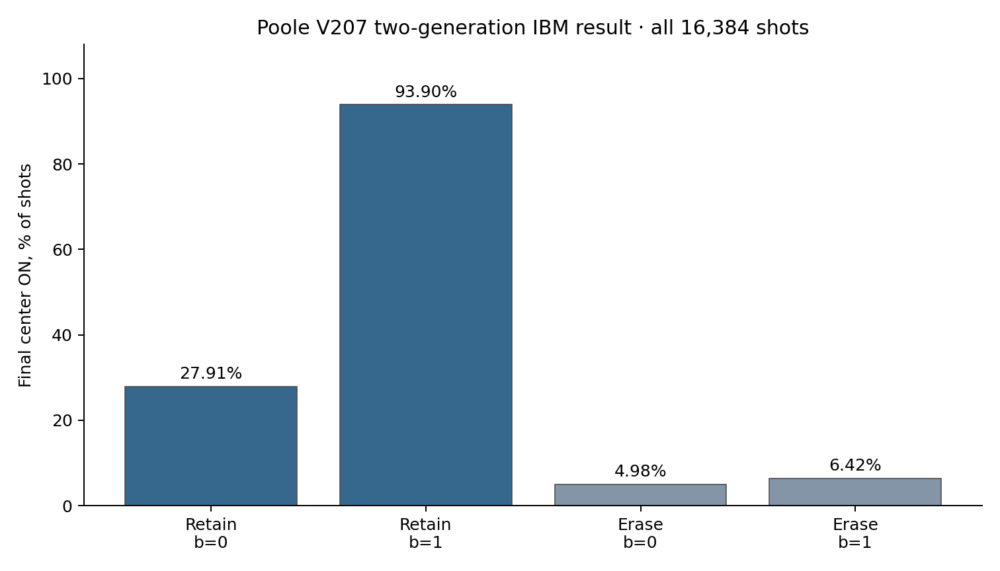

# Poole V207 — Two-Generation Causal-Cone Experiment on IBM Quantum

**Public reproducibility release v1.1.1 (source-available licensed edition) · original experimental version v2.4 · 20 October 2026**  
**Researcher:** Rooke A. Poole  
**Original job:** `dbaoflpgv2cc73e75v10` · `ibm_kingston` · 19 October 2026 UTC  
**Scope:** Two successive V207-derived **classical Boolean** update steps implemented on a 9-qubit quantum processor, including a midpoint central reset and a neighboring-memory erasure control.

## License and permitted use

**Source available, not open source.** Copyright © 2026 Rooke Alan Poole, all rights reserved. This release adopts the author's existing [Poole Manifold research-permitted terms](LICENSE): anyone may inspect and run this kit for **personal or academic reproduction**, cite it with attribution, and share the official release link. **Commercial use, redistribution with another project, and patent use require written permission**. A researcher working on behalf of a commercial institution should arrange permission first. See [LICENSE_SCOPE.md](LICENSE_SCOPE.md) for examples and provenance. The original V207 repository remains under its own terms.

## NEW in v1.1: Run a fresh IBM replication with your own account

**Windows:** Run `SETUP_IBM_WINDOWS.bat` once, then `RUN_ON_IBM.bat`. The menu lists accessible IBM processors, compiles all 16 cases without QPU use, and requires the exact phrase `SUBMIT 16` before creating a paid/allocation-consuming hardware job. It also retrieves jobs and exports sanitized results without sharing API keys. A paste-friendly masked key-entry popup is included for Windows users, or researchers can use credentials already saved in Qiskit. **No key is saved by this package.**

**Linux/macOS:** Install `requirements-hardware.txt` in your own virtual environment and run `python -m hardware.ibm_runner menu`. See [HARDWARE_QUICKSTART.md](HARDWARE_QUICKSTART.md) for a complete walkthrough and command-line commands. An optional Qiskit import test (`RUN_LOCAL_QISKIT_CHECK.bat`) runs without connecting to IBM.

Hardware replication uses **the 16 reconstructed QASM circuits**, compiled for each researcher's own accessible IBM processor. The historical native Kingston QPY programs are included for archival inspection, **not** assumed portable or logically identical gate by gate. The original offline statistics and all original circuit/data artifacts are unchanged from v1.0.

**QPU safety:** Listing/compiling uses IBM account access but *not* QPU execution. Submitting a new job consumes the researcher's own allocation and requires explicit approval. Live native compilation on a real IBM account has **not** been tested in this packaging environment; robust mocked end-to-end and credential-free tests have been performed instead.

> **Primary conclusion:** The output of an engineered two-generation Poole V207 causal cone depends on retained neighboring history after its intermediate central bit is reset. This experiment tests programmed *computational-basis* history dependence. It does **not** establish autonomous quantum coherence, intrinsic hardware non-Markovianity, a protected quantum memory, or a Poole-specific quantum advantage.

## Results reproduced from the released IBM counts

| Measure | Original IBM result |
|---|---:|
| Circuit conditions | 16 (8 source histories × retained/erased controls) |
| Shots | **16,384** (1,024 per condition) |
| Correct final center bits | **15,272 / 16,384 = 93.21%** |
| Retained neighboring-history contrast (`b=1` minus `b=0`) | **65.99 percentage points** |
| Neighbor-erased contrast | **1.44 percentage points** |
| Retained-minus-erased difference-in-differences | **64.55 percentage points** |
| 95% normal, independent-shot-only CI for difference-in-differences | **62.70–66.40 percentage points** |



## Reproduce the numerical result in one command

**No Qiskit, NumPy, IBM account, internet access, API key, or QPU credits required.** Python 3.10+ with the standard library is sufficient.

```bash
python reproduce.py
```

Expected output includes:

```text
Correct center bits: 15272/16384 = 93.212891%
Retained middle-bit contrast: 65.9912%
Erased middle-bit contrast: 1.4404%
Difference-in-differences: 64.5508% (95% shot-only CI 62.6983% to 66.4033%)
Golden-value checks: PASS
```

The command produces `results/verified_summary.json` and `results/per_pub.csv` from **the released full nine-bit outcome histograms**, without postselection. Run all automated checks with:

```bash
python -m unittest discover -s tests -v
python scripts/verify_reconstructed_circuits.py
python scripts/verify_hashes.py
```

On Windows, double-click `RUN_OFFLINE_REPRODUCTION.bat`. This performs no hardware submission and does not request account credentials.

## Check the actual V207 source correspondence

The input is a reproducibly reconstructed `250×250×10` V207 state at time `t=250`, not a full CA running on IBM. For the eight selected initial triples, direct full-lattice evolution agrees with the two-step Boolean causal cone. This requires optional NumPy and SciPy:

```bash
python -m pip install numpy scipy
python source/validate_source.py
```

For the considerably more expensive rebuild of the historical CA input state from the original write/strike procedure, see `source/reconstruct_dark.py`. The bytewise equality of the reconstructed A/B snapshots to a separately reproduced snapshot has been checked, **but the older original snapshot was unavailable for a direct historical hash comparison**.

Read `METHODS_AND_SCOPE.md` for the exact CA rule, the Boolean circuit and limitations. The **second-generation shortcut applies to the specified reachable states, not to arbitrary neighbor configurations**. Off-sector counterexamples are released in `data/verified_off_sector_counterexamples.json`.

## Inspect the *original* IBM circuits

Two different circuit artifacts are intentionally kept separate:

1. `circuits/original_ibm_qpy/original_ibm_pub00.qpy` … `original_ibm_pub15.qpy`: 16 **authentic serialized circuits extracted directly from the IBM job archive**, independently byte-compared to the prior archive and SHA-256 checked. These are not newly generated reconstructions.
2. `circuits/reconstructed_qasm/v24_*.qasm`: 16 **human-readable source-level reconstructions** implementing the documented F1/F2 and reset intervention. They have been checked against every reachable computational-basis history, but they are **not asserted to be identical to the submitted transpiled gate sequence**.

With Qiskit installed locally, examine the original QPY operations, measured-wire maps and reset positions using:

```bash
python scripts/verify_qpy_optional.py
```

This optional QPY disassembly has **not been run in this packaging environment** because Qiskit is unavailable. A QPY structural check is not by itself a universal quantum-channel equivalence proof.

## Files and data provenance

| Path | Purpose |
|---|---|
| `data/sanitized_ibm_9bit_counts.json` | Losslessly aggregated original IBM computational-basis measurement counts: all nine measured bits, 16 PUBs, 1,024 shots each |
| `data/sanitized_provenance.json` | Job identifier, backend, creation time, original private ZIP checksum, extracted original QPY hashes; no IBM account ID |
| `data/verified_off_sector_counterexamples.json` | Counterexamples showing the optimized second-step formula is not an unrestricted V207 update |
| `circuits/original_ibm_qpy/` | Original submitted QPY programs extracted from provider job |
| `circuits/reconstructed_qasm/` | Human-readable QASM, reconstructive rather than original compiled circuitry |
| `source/reconstructed_dark_pair_t250.npz` | Reproduced V207 background A/B states; 625,000 cells each |
| `source/validate_source.py` | Full-lattice source-versus-causal-cone checks |
| `results/` | Recomputed numerical summary and per-circuit table |
| `HARDWARE_QUICKSTART.md` | Easy-to-follow own-account IBM hardware replication workflow |
| `hardware/` | Backend selection, no-cost compilation, frozen submission, result retrieval, statistical analysis, sanitized export |
| `REPRODUCE_ON_HARDWARE.md` | Concise hardware reproduction overview |
| `SHA256SUMS.txt` | Release artifact hashes (excluding regenerable `results/` files) |

**Privacy:** The original IBM provider ZIP contains an account-identifying `user_id` field and is deliberately **not** included. The public outcome histograms preserve every nine-bit measurement distribution. Use `scripts/verify_raw_archive_optional.py /path/to/original.zip` (requires NumPy) to verify the sanitized release against a privately held original export. The original private ZIP's SHA-256 is recorded in `data/sanitized_provenance.json`.


**Source reference:** [Poole V207 Immortal Latch at pinned Git commit `17f6ca709ed45ed207aa45f680cb3eb18be14a74`](https://github.com/rookepoole/Poole-Manifold/blob/17f6ca709ed45ed207aa45f680cb3eb18be14a74/Experiments/CPU_Logic/CPU%20ARCHITECTURE%20%28V207%29%20%23%20SHOWCASE%20BLUEPRINT-%20The%20Immortal%20Latch%20%28Radiation-Hardened%20SRAM%29).
